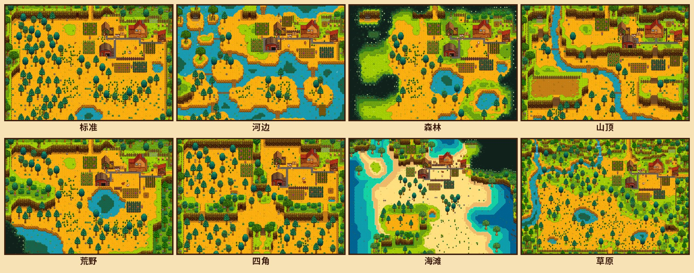
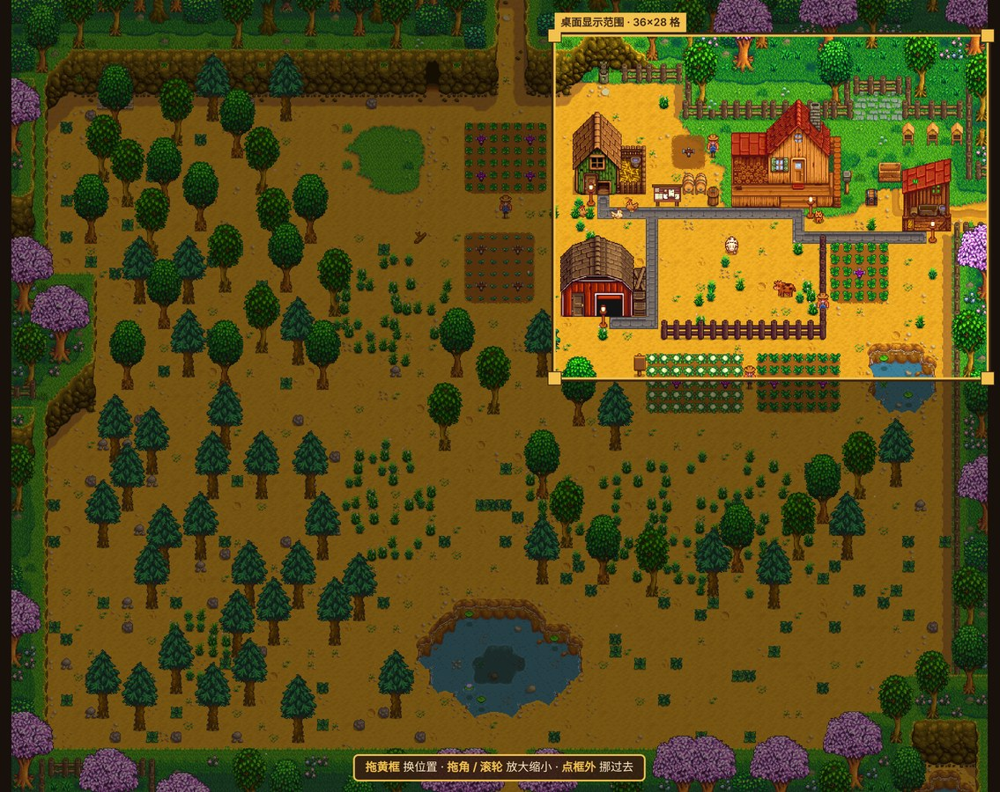
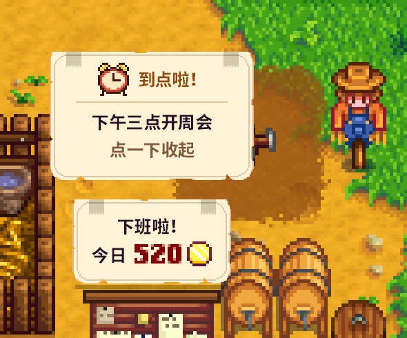

# Stardew Desk v1.2 更新说明

> ⚠️ **升级后第一次打开**会弹出读取窗口，重新从游戏里读一遍画面（多了 7 张农场地图和游戏字体，大约半分钟）。读完就和平时一样了，之前的布局、待办、设置都还在。

---

## 🗺 八种农场地图，随便换

设置窗口 → **布置 → 农场地图**，标准、河边、森林、山顶、荒野、四角、海滩、草原八选一，地形都从你自己的游戏里读取。

- 农舍放在游戏里那张地图原本的位置（草原农场的农舍在右上角，也照游戏来）。
- 鸡舍、畜棚、马厩、作物田、蜂房按原来的相对位置摆，碰到水或悬崖会就近挪开。
- 换之前的布局会自动备份到「我的布局」，想回去点「套用」就行。
- **从存档导入布局**现在会直接换成存档的那张地图，不再一律按标准农场的地形摆。

## 🔭 新的「视野」页：桌面显示哪一块，自己框

很多人不知道桌面上显示的范围可以换，所以把它单独做成了一页。切到「视野」，右边是整张地图，**黄框就是桌面上显示的那一块**：

- **拖黄框**：换位置；**拖四个角**或**滚轮**：放大缩小；**点框外**：把框挪过去。
- 「＋ 放大 / － 缩小」按整倍数缩放，像素画保持清晰；框上会标着「一屏 36×28 格」。
- 勾 **「锁定大小」** 之后只能拖动位置，不会不小心缩放。
- 「框住院子」一键把框挪到农舍、鸡舍、畜棚那一片，「恢复默认视野」回到最初的构图。

### 镜头跟随鼠标：改成「移到屏幕边缘时移动」

| | |
|---|---|
| 不跟随 | 桌面上的农场一直停在黄框这里 |
| **移到屏幕边缘时移动** | 鼠标在屏幕中间随便动，画面都不动；把鼠标移到屏幕四周边缘停一下，视野才会慢慢往那边移，到农场边上就停。鼠标离开边缘，画面就停在移到的地方。关掉跟随，画面会回到黄框 |

## ⏰ 公告板和到点提醒换成游戏里的字

- 公告板上的字（上方的便签、展开的木板、到点提醒）改用**从游戏里读出来的中文像素字体**，和游戏菜单里的字一模一样。
- 到点提醒的 ⏰ 表情换成了游戏配色的**像素小闹钟**，到点时会左右晃着响铃；便签上写着几件事到点、具体是什么，点一下收起。
- **「添加待办」小窗口**也换成了公告板的木框和纸条：游戏字体、游戏里的勾选框，提醒时间用游戏选项菜单的 ◀ ▶ 箭头来调（今天 / 明天…，每次 15 分钟，按住连续调，也能用滚轮），不再是系统对话框。
- 日期框和时间框也能**直接输入**：点一下框，写「10/25」「10月25日」「明天」「周五」「下周一」，或「14:30」「1430」「下午3点半」「2:30pm」，回车或 Tab 确认，时间可以精确到分钟；没看懂的写法会标红提示。
- 万一有字游戏字体里没有（比如生僻字），会用系统字体补上，不会显示成方块。

## 🎵 背景音乐可以自己选歌

设置窗口新增 **音乐** 页（菜单栏叶子 → 背景音乐 →「选歌…」也能直接打开）：

- **跟随季节**：和以前一样，现在是哪个季节就放游戏里那一季的三首。
- **我的歌单**：从 38 首游戏配乐里勾自己喜欢的——四季 12 首，加上星露谷序曲、鹈鹕镇、星之果实酒吧、深林之中、云之国、花舞节、月光水母之舞、星露谷展览会、万灵节、冬日星盛宴、夜市、几位村民的主题曲、矿井和姜岛。可以**随机**或**按顺序**放，每首之间只停几秒。
- 每首旁边的 **▶ 马上试听**，背景音乐关着也能单听这一首；「下一首」直接跳过。
- 「本季」「全选」「清空」一键勾选；勾上第一首时自动切到「我的歌单」。
- 每首第一次播放时才从你的游戏里取出来（等几秒），之后就存在本机。

## 🌐 中文 / English

- 设置窗口右上角新增 **「中 / EN」**，一键切换界面语言，切换后桌面、菜单、提醒、通知马上跟着变。
- 菜单栏叶子 → 更多 → **语言 / Language**：跟随系统 / 中文 / English。默认「跟随系统」：系统是中文就显示中文，否则显示英文。
- 英文模式下公告板上的字也用游戏自己的像素字体；配乐用游戏原声的英文曲名。

## 🛠 布置时也能放大看

- 「布置」页新增 **看得更清楚**：－ / ＋（或滚轮）放大缩小设置窗口里的地图，「全图」「桌面」一键切换，「网格」显示格子。
- 放大后大小保持不变，**鼠标停在窗口边上会往那边看**，拖着建筑也能一路拖过去；也可以按住空地拖动。

## 🎨 设置面板重新排版

- 面板分成 **场景 / 视野 / 布置 / 公告板 / 音乐** 五页。
- 按钮都改成等宽排列，「恢复默认」「自动」不再单独掉到下一行；天气按钮排成整齐的两行。
- 「恢复自动铺设」放在「画路和围栏」标题旁边，「恢复默认布局」挪到「布置」页最底下，不容易误点。
- 「场景」页顶部加了一句「桌面上显示的是农场的哪一块？」，点一下直接去「视野」页。

## 这一版还包括（v1.1.1 之后陆续加的）

- **从存档导入布局**：读取你的星露谷存档（只读），农舍、鸡舍、畜棚、筒仓、鱼塘、温室、小屋……摆到和存档里一样的位置，鸡、奶牛、宠物也照存档来。
- **我的布局**：布局随改随存，可以起名多存几份随时切换；换地图、导入存档、恢复默认、套用之前自动备份。
- **到点提醒**：待办可以设提醒时间，到点在农场上贴便签，同时发系统通知；电脑睡眠或程序没开时错过的，下次打开补发。
- **桌面上直接添加待办**：展开的公告板上点「＋ 添加待办」，写完回车就贴上去；待办多了用 ▲▼ 或滚轮翻页。
- 挡路的树、稻草人、木牌、箱子，鼠标停上去点 × 就能删掉；「恢复默认」会把它们请回来。
- 设置面板可以「收起」（或按 `H`），不再盖住农场。

---

## 下载

| | |
|---|---|
| Mac（macOS 14+） | `Stardew-Desk-Mac.zip`：解压后把 App 拖进「应用程序」 |
| Windows 10 / 11 | `Stardew-Desk-win.zip`：解压到固定文件夹，双击 `Stardew Desk.exe` |

已经装了旧版的：Mac 用菜单栏叶子 → 更多 →「更新到最新版本」，或者下载新的 App 覆盖；Windows 解压覆盖原来的文件夹即可。设置和布局不会丢。

需要电脑上装着正版《星露谷物语》。这是粉丝自制的非官方小工具，和 ConcernedApe 无关，不含任何游戏素材。
